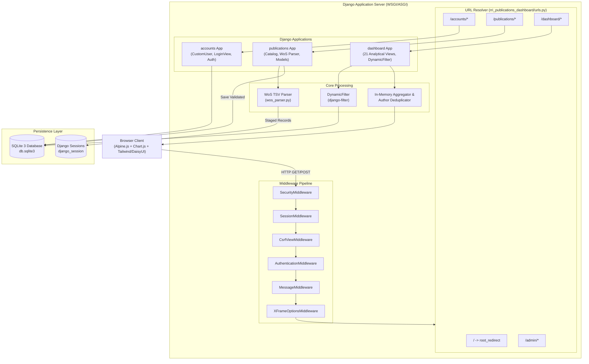
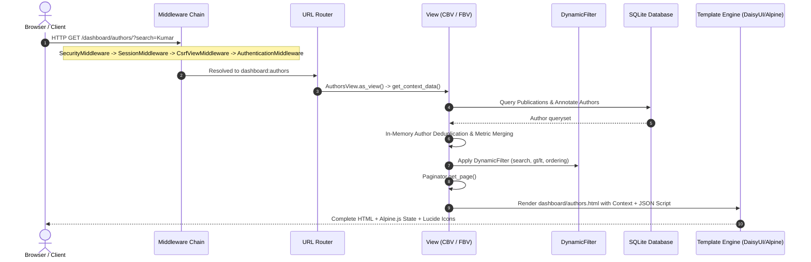
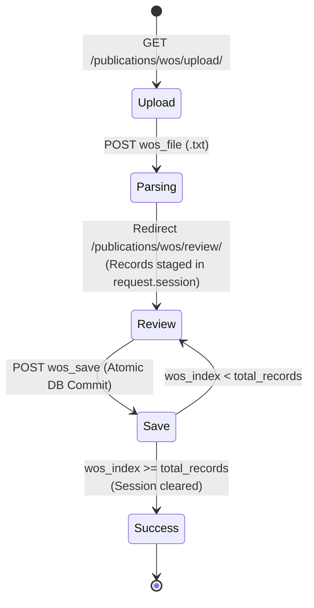

# Project Structure and Architecture: RRI Publications Dashboard

## 1. Annotated Directory Structure

The repository is organized as a multi-application Django monolith with co-located static assets, Tailwind configuration, and Django HTML templates.

```
research-insights/
├── .djlintrc                       # Configuration for djLint template linter
├── .env.example                    # Template environment variables (PORT, DEBUG, ALLOWED_HOSTS)
├── .gitignore                      # Git exclusion rules (.env, venv, db.sqlite3, *.pyc)
├── db.sqlite3                      # SQLite development database (pre-populated with schema)
├── exclude_me.txt                  # Custom file list for exclusions/packaging
├── makefile                        # GNU Make automation for dev tasks and Apache deployment
├── manage.py                       # Standard Django command-line execution entry point
├── pyproject.toml                  # Python tool configurations (djlint, ruff lint rules)
├── README.md                       # Setup and installation documentation
├── requirements.txt                # Pinned Python package dependencies
│
├── accounts/                       # DJANGO APP: User authentication and role management
│   ├── admin.py                    # CustomUser registration in Django Admin
│   ├── apps.py                     # AccountsConfig application declaration
│   ├── forms.py                    # CustomUserCreationForm, CustomAuthenticationForm (Remember Me)
│   ├── migrations/
│   │   └── 0001_initial.py         # Initial migration creating CustomUser table
│   ├── models.py                   # CustomUser (inherits AbstractUser; role choices)
│   ├── tests.py                    # Unit tests placeholder (currently empty)
│   ├── urls.py                     # URL routing for login, logout, password change/reset
│   └── views.py                    # CustomLoginView with session expiry handling
│
├── dashboard/                      # DJANGO APP: Bibliometrics analytics and visualizations
│   ├── admin.py                    # Admin registration placeholder (empty)
│   ├── apps.py                     # DashboardConfig application declaration
│   ├── context_processors.py       # dashboard_sidebar: hierarchical navigation menu items
│   ├── filters.py                  # DynamicFilter, ImpactFilter, PublicationFilter classes
│   ├── models.py                   # Models placeholder (empty; queries publications models)
│   ├── tables.py                   # PublicationTable (django-tables2; unused phantom code)
│   ├── templates/                  # Base and dashboard templates
│   │   ├── base.html               # Main root HTML layout (duplicated doctype wrapper bug)
│   │   ├── components/             # Reusable UI component partials
│   │   │   ├── authors_filters.html# Specialized filter bar for Authors view
│   │   │   ├── chart_card.html     # Canvas card wrapper for Chart.js
│   │   │   ├── data_table.html     # Generic table container with pagination
│   │   │   ├── empty_state.html    # Empty result placeholder with customizable icon/text
│   │   │   ├── filter_bar.html     # Standardized dynamic filter form partial
│   │   │   ├── page_header.html    # Header card with breadcrumbs, icon, title, subtitle
│   │   │   ├── pagination.html     # Join/button pagination component
│   │   │   └── stats_cards.html    # DaisyUI stat card with color tokens
│   │   ├── dashboard/              # 11 dashboard analytics page templates + drilldowns
│   │   │   ├── author_detail.html
│   │   │   ├── authors.html
│   │   │   ├── collaboration.html
│   │   │   ├── country_collaboration.html
│   │   │   ├── dashboard.html      # Main executive dashboard
│   │   │   ├── departments.html
│   │   │   ├── document_types.html
│   │   │   ├── impact.html
│   │   │   ├── institution_collaboration.html
│   │   │   ├── journals.html
│   │   │   ├── rri_role.html
│   │   │   ├── sidebar.html        # Collapsible Alpine.js sidebar navigation
│   │   │   └── trends.html
│   │   └── tables/                 # Table-specific partials (authors_table, impact_table)
│   ├── tests.py                    # Unit tests placeholder (currently empty)
│   ├── urls.py                     # 21 dashboard routes and drill-down patterns
│   └── views.py                    # 2,112-line module housing 21 TemplateView CBVs
│
├── publications/                   # DJANGO APP: Core publication data & WoS ingestion
│   ├── admin.py                    # ModelAdmin registrations with inlines and autocomplete
│   ├── apps.py                     # PublicationsConfig application declaration
│   ├── forms.py                    # PublicationForm and AuthorForm with hidden JSON fields
│   ├── migrations/
│   │   ├── 0001_initial.py         # Schema creation for Publication, Author, Journal, etc.
│   │   └── 0002_alter_..._article_number.py # Added article_number (schema drift with models.py)
│   ├── models.py                   # Publication, Author, Affiliation, Journal, Department, Citation
│   ├── templatetags/
│   │   └── json_extras.py          # Custom filter `json_loads` for decoding JSON in templates
│   ├── tests.py                    # Unit tests placeholder (currently empty)
│   ├── urls.py                     # Routes for catalog list, detail, and WoS staging flow
│   ├── utils/
│   │   └── wos_parser.py           # Web of Science TSV/C1 regex address & author parsing logic
│   ├── views.py                    # PublicationsListView, DetailView, wos_upload, wos_review, wos_save
│   └── views_dashboard.py          # Legacy/unused dashboard FBV prototype
│
├── rri_publications_dashboard/     # DJANGO CONFIGURATION PACKAGE
│   ├── asgi.py                     # ASGI deployment entry point
│   ├── settings.py                 # Core Django settings (database, apps, middleware)
│   ├── urls.py                     # Root URLconf routing to admin, accounts, pubs, dashboard
│   └── wsgi.py                     # WSGI deployment entry point
│
├── static/                         # PROJECT STATIC ASSETS
│   └── js/
│       ├── alpine.min.js           # Alpine.js reactive UI framework
│       ├── chart.min.js            # Chart.js charting engine
│       └── lucide.min.js           # Lucide SVG icon engine
│
├── templates/                      # PROJECT-WIDE TEMPLATES
│   ├── publications/               # Publication catalog and WoS upload/review templates
│   │   ├── create_publication.html # Unlinked manual creation template (orphan)
│   │   ├── edit_publication.html   # Unlinked manual edit template (orphan)
│   │   ├── publication_detail.html # Publication detail view template
│   │   ├── publications_list.html  # Publications catalog list with KPI cards
│   │   ├── review.html             # Multi-record WoS review and staging template
│   │   ├── upload.html             # WoS file upload dropzone template
│   │   └── wos_success.html        # WoS import completion screen
│   └── registration/               # Django auth templates (login, password reset/change)
│
└── theme/                          # TAILWIND CSS INTEGRATION APP
    ├── apps.py                     # ThemeConfig
    ├── static/css/dist/styles.css  # Production compiled Tailwind CSS stylesheet (144 KB)
    └── static_src/                 # Node.js / PostCSS / Tailwind v4 build source
        ├── package.json            # Node dependencies (tailwindcss, daisyui, postcss)
        ├── postcss.config.js       # PostCSS plugins configuration
        └── src/styles.css          # Tailwind entry file (@import "tailwindcss"; @plugin "daisyui";)
```

---

## 2. High-Level System Architecture



---

## 3. Application Boundaries and Responsibilities

The codebase divides concerns across four specialized Django applications:

| Application | Responsibilities | Core Models / Modules | Key External Interactions |
| :--- | :--- | :--- | :--- |
| **`accounts`** | User authentication, identity management, user roles (`admin`, `user`, `viewer`), session duration control ("Remember Me"). | [`CustomUser`](../../accounts/models.py#L7), [`CustomLoginView`](../../accounts/views.py#L6), [`CustomAuthenticationForm`](../../accounts/forms.py#L11) | Interacts with Django Auth subsystem and standard session middleware. |
| **`publications`** | Master bibliometric data persistence; Web of Science TSV export ingestion; institutional affiliation detection; publications catalog and detail presentation. | [`Publication`](../../publications/models.py#L125), [`Author`](../../publications/models.py#L40), [`Affiliation`](../../publications/models.py#L75), [`Journal`](../../publications/models.py#L27), [`Department`](../../publications/models.py#L12), [`wos_parser.py`](../../publications/utils/wos_parser.py) | Ingests external `.txt` TSV export files. Serves as the primary data model layer for `dashboard`. |
| **`dashboard`** | Quantitative bibliometrics analytics; multi-facet query filtering; aggregations across journals, departments, authors, document types, and geographical collaborations; JSON serialization for client charts. | [`DynamicFilter`](../../dashboard/filters.py#L27), [`DashboardHomeView`](../../dashboard/views.py#L17), 20 specialized analytical views, [`dashboard_sidebar`](../../dashboard/context_processors.py#L6) | Queries `publications` models; injects navigation context globally; renders Chart.js datasets. |
| **`theme`** | Node.js and PostCSS compilation pipeline for Tailwind CSS v4 and DaisyUI 5; static asset distribution. | [`theme/static_src/package.json`](../../theme/static_src/package.json), [`theme/static/css/dist/styles.css`](../../theme/static/css/dist/styles.css) | Compiled static CSS consumption by Django templates. |

---

## 4. Request Lifecycle and Middleware Flow



### Middleware Pipeline Execution Order

Configured in [`rri_publications_dashboard/settings.py:48-64`](../../rri_publications_dashboard/settings.py#L48-L64):

1. **`django.middleware.security.SecurityMiddleware`**: Enforces SSL redirects and security headers (currently non-enforcing due to dev settings).
2. **`django.contrib.sessions.middleware.SessionMiddleware`**: Hydrates `request.session` from `django_session` cookie; critical for the WoS staging workflow.
3. **`django.middleware.common.CommonMiddleware`**: Handles trailing slashes, URL normalization, and `APPEND_SLASH`.
4. **`django.middleware.csrf.CsrfViewMiddleware`**: Validates `_csrftoken` on POST submissions (`wos_upload`, `wos_save`, `login`, `logout`).
5. **`django.contrib.auth.middleware.AuthenticationMiddleware`**: Resolves `request.user` to a `CustomUser` instance.
6. **`django.contrib.messages.middleware.MessageMiddleware`**: Powers flash messages (`messages.error`, `messages.success`).
7. **`django.middleware.clickjacking.XFrameOptionsMiddleware`**: Enforces `SAMEORIGIN` clickjacking defense.
8. **`django_browser_reload.middleware.BrowserReloadMiddleware`** *(DEBUG only)*: Injects hot-reloading scripts for local template editing.

---

## 5. View Architecture Patterns

The application employs two contrasting view paradigms:

### 5.1 Class-Based Views (CBVs) for Catalogs and Dashboards

All 21 analytical views in [`dashboard/views.py`](../../dashboard/views.py) and the 2 catalog views in [`publications/views.py`](../../publications/views.py) inherit from `django.views.generic.TemplateView` or `DetailView`.

- **Declarative Configuration**: Views declare filtering rules via class attributes:
  ```python
  search_fields = ["title", "journal__name", "doi"]
  exact_filters = ["document_type", "collaboration_type"]
  date_filters = ["date_published"]
  sortable_columns = ["date_published", "title"]
  gt_filters = ["total_publications"]
  lt_filters = ["total_publications"]
  ```
- **Context Construction Pipeline**: Every view overrides `get_context_data(**kwargs)` to:
  1. Construct base ORM querysets with `select_related()` and `prefetch_related()`.
  2. Instantiate `DynamicFilter(request.GET, queryset=qs, view=self)`.
  3. Compute aggregate KPI metrics (`Sum`, `Avg`, `Count`, `Max`).
  4. Perform in-memory data restructuring or Python deduplication where ORM grouping is insufficient.
  5. Paginate using `django.core.paginator.Paginator`.
  6. Return breadcrumbs, filter forms, page objects, and chart datasets.

### 5.2 Function-Based Views (FBVs) for Web of Science Staging

The Web of Science ingestion pipeline in [`publications/views.py:200-367`](../../publications/views.py#L200-L367) is implemented as a multi-step state machine using function-based views:



- **`wos_upload`**: Reads uploaded `.txt` file, calls `parse_wos_file()`, stores the list of parsed record dicts into `request.session["wos_records"]`, sets `request.session["wos_index"] = 0`, and redirects to `wos_review`.
- **`wos_review`**: Retrieves the current record by index from session; pre-populates `PublicationForm` and an `AuthorFormSet` (`modelformset_factory`); runs heuristic RRI affiliation matching; attaches decoded JSON affiliations for template display.
- **`wos_save`**: Validates publication and author forms inside `transaction.atomic()`; saves `Publication`, iterates through formset to save `Author` and `AuthorAffiliation` records; increments `request.session["wos_index"]`; loops back to review until exhausted; cleans up session and redirects to `wos_success`.

---

## 6. Shared Utilities and Cross-Cutting Concerns

1. **`dashboard.filters.DynamicFilter`** ([`dashboard/filters.py:27-164`](../../dashboard/filters.py#L27-L164)):
   - Dynamically inspects the target model's `choices` and builds dropdown `ChoiceFilter` widgets with `onchange="this.form.submit()"`.
   - Generates numeric range filters (`_gt`, `_lt`) and date range filters (`_from`, `_to`).
   - Implements multi-field `icontains` text search via OR-chained `Q` expressions.
2. **`dashboard.context_processors.dashboard_sidebar`** ([`dashboard/context_processors.py:6-94`](../../dashboard/context_processors.py#L6-L94)):
   - Injected into all templates via `TEMPLATES['OPTIONS']['context_processors']`.
   - Generates a structured multi-tier navigation menu (Analytics, Publications, Management) with icons and resolved URL names.
3. **`publications.templatetags.json_extras`** ([`publications/templatetags/json_extras.py:1-12`](../../publications/templatetags/json_extras.py#L1-L12)):
   - Supplies `json_loads` filter to allow parsing JSON strings directly inside Django templates.
4. **`dashboard/templates/components/` Partial Architecture**:
   - High degree of visual DRY compliance. Common layouts (`page_header.html`, `stats_cards.html`, `filter_bar.html`, `chart_card.html`, `pagination.html`) are standardized and parameterized across all 11 dashboard pages.

---

## 7. Architectural Deficiencies and Coupling

1. **Severe View Proliferation and Monolithic Bloat in `dashboard/views.py`**:
   - `dashboard/views.py` spans 2,112 lines containing 21 separate class-based views. Many views replicate nearly identical aggregation, merging, and context-building logic.
2. **Excessive In-Memory Data Processing**:
   - In [`dashboard/views.py:358-387`](../../dashboard/views.py#L358-L387) (`AuthorsView`), [`1276-1300`](../../dashboard/views.py#L1276-L1300) (`CountryCollaborationView`), and [`1471-1500`](../../dashboard/views.py#L1471-L1500) (`InstitutionCollaborationView`), large datasets are pulled entirely into Python memory, iterated with `for` loops, stripped, merged into dictionaries, sorted using Python `list.sort()`, and sliced for pagination.
   - **Risk**: As publication counts grow into thousands of records, these views will experience severe latency and memory spikes.
3. **Session Store Abuse for File Staging**:
   - Web of Science files containing hundreds of publications are loaded into `request.session["wos_records"]`. Serializing multi-megabyte dictionaries into SQLite database session rows degrades database performance and session handling.
4. **Orphaned and Dead Modules**:
   - `publications/views_dashboard.py`: A 109-line legacy dashboard prototype rendering a non-existent template.
   - `dashboard/tables.py`: Imports `django-tables2` (uninstalled in requirements), unused by any view.
   - `templates/publications/create_publication.html` & `edit_publication.html`: Complex publication forms with no corresponding routes or views.

