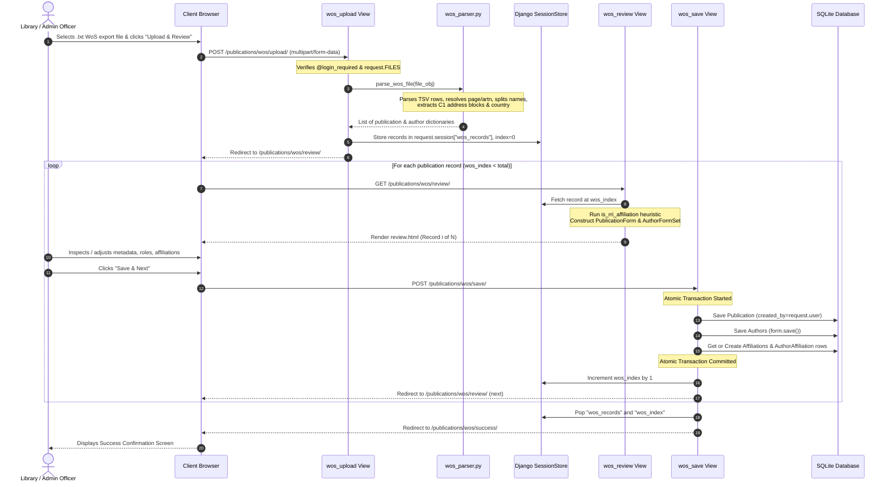
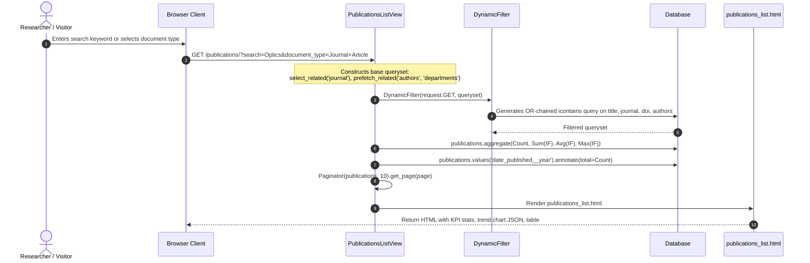
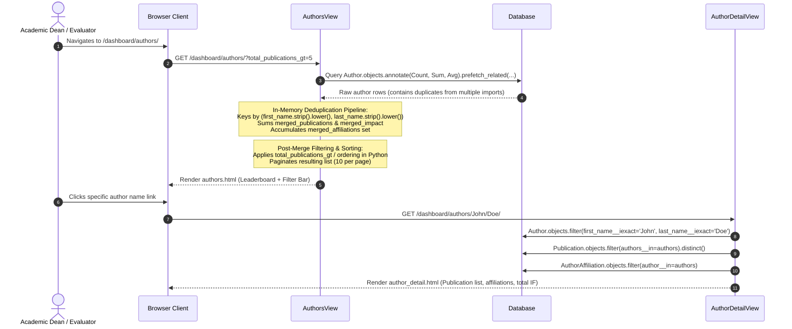
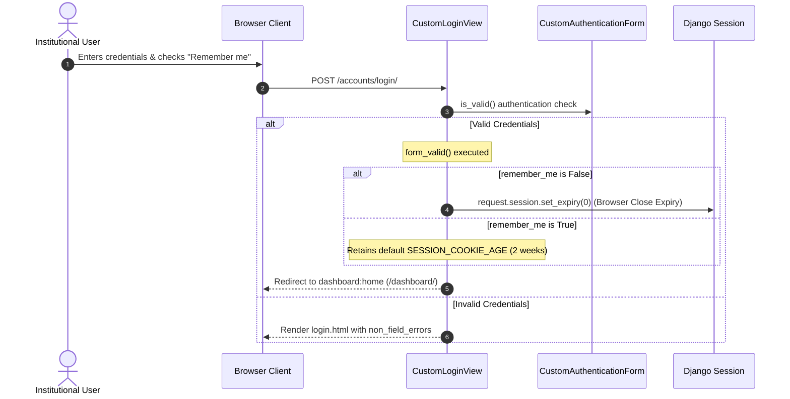

# Features and Business Workflows: RRI Publications Dashboard

## 1. Feature Implementation Status Matrix

| Feature Module | Primary Routes | Implementation Status | Verification Evidence | Key Limitations / Gaps |
| :--- | :--- | :--- | :--- | :--- |
| **Web of Science File Ingestion** | `/publications/wos/upload/`, `review/`, `save/` | **Implemented & Verified** | [`publications/views.py:200-367`](../../publications/views.py#L200-L367), [`wos_parser.py`](../../publications/utils/wos_parser.py) | No file size validation; large payloads staged in session; naive `Author` duplication on save |
| **Publications Catalog & Filtering** | `/publications/` (`publications:list`) | **Implemented & Verified** | [`publications/views.py:48-171`](../../publications/views.py#L48-L171), [`publications_list.html`](../../templates/publications/publications_list.html) | Pagination drops active filters except `search`; public without auth |
| **Publication Detail View** | `/publications/<int:pk>/` | **Implemented & Verified** | [`publications/views.py:173-195`](../../publications/views.py#L173-L195), [`publication_detail.html`](../../templates/publications/publication_detail.html) | Public without auth; displays metadata, affiliations, citations |
| **Executive Analytics Dashboard** | `/dashboard/` (`dashboard:home`) | **Implemented & Verified** | [`dashboard/views.py:17-108`](../../dashboard/views.py#L17-L108), [`dashboard.html`](../../dashboard/templates/dashboard/dashboard.html) | Public without auth; dynamic filters, Chart.js trends, recent pubs |
| **Document Types Analytics** | `/dashboard/documents/`, `document/<type>/` | **Implemented & Verified** | [`dashboard/views.py:110-270`](../../dashboard/views.py#L110-L270), [`document_types.html`](../../dashboard/templates/dashboard/document_types.html) | Filter by Journal Article, Conference Paper, Book Chapter, etc. |
| **Authors Intelligence & Leaderboard**| `/dashboard/authors/`, `authors/<first>/<last>/`| **Implemented & Verified** | [`dashboard/views.py:272-632`](../../dashboard/views.py#L272-L632), [`authors.html`](../../dashboard/templates/dashboard/authors.html) | In-memory author merging; lookup by first/last string instead of ID |
| **Journals & Impact Metrics** | `/dashboard/journals/`, `journal/<id>/` | **Implemented & Verified** | [`dashboard/views.py:635-842`](../../dashboard/views.py#L635-L842), [`journals.html`](../../dashboard/templates/dashboard/journals.html) | Aggregates publisher counts and journal impact factor averages |
| **Departmental Productivity** | `/dashboard/departments/`, `departments/<pk>/` | **Implemented & Verified** | [`dashboard/views.py:844-1053`](../../dashboard/views.py#L844-L1053), [`departments.html`](../../dashboard/templates/dashboard/departments.html) | Tracks departmental output and department-level impact factor |
| **Collaboration Scope Analytics** | `/dashboard/collaboration/`, `collaboration/<type>/`| **Implemented & Verified** | [`dashboard/views.py:1055-1220`](../../dashboard/views.py#L1055-L1220), [`collaboration.html`](../../dashboard/templates/dashboard/collaboration.html) | National, International, Departmental, National/International |
| **Geographic Collaboration** | `/dashboard/country/collaboration/` | **Implemented & Verified** | [`dashboard/views.py:1222-1415`](../../dashboard/views.py#L1222-L1415), [`country_collaboration.html`](../../dashboard/templates/dashboard/country_collaboration.html)| Semicolon sanitization in Python memory; country co-authorship |
| **Institutional Collaboration** | `/dashboard/institution/collaboration/` | **Implemented & Verified** | [`dashboard/views.py:1417-1607`](../../dashboard/views.py#L1417-L1607), [`institution_collaboration.html`](../../dashboard/templates/dashboard/institution_collaboration.html)| Partner university tracking; in-memory deduplication |
| **Historical & Year Trends** | `/dashboard/trends/`, `trends/<year>/` | **Implemented & Verified** | [`dashboard/views.py:1609-1764`](../../dashboard/views.py#L1609-L1764), [`trends.html`](../../dashboard/templates/dashboard/trends.html) | Multi-year publication trajectories and citation growth metrics |
| **Journal Impact Analysis** | `/dashboard/impact/`, `impact/<journal_id>/` | **Implemented & Verified** | [`dashboard/views.py:1766-1904`](../../dashboard/views.py#L1766-L1904), [`impact.html`](../../dashboard/templates/dashboard/impact.html) | High-impact publication tracking and journal impact factor distribution |
| **RRI Institutional Roles** | `/dashboard/rri/role/`, `rri-role/<role>/` | **Implemented & Verified** | [`dashboard/views.py:1906-2112`](../../dashboard/views.py#L1906-L2112), [`rri_role.html`](../../dashboard/templates/dashboard/rri_role.html) | Faculty, Scholar, Postdoc, Staff, External breakdowns |
| **User Authentication & Session** | `/accounts/login/`, `/logout/` | **Implemented & Verified** | [`accounts/views.py:6-18`](../../accounts/views.py#L6-L18), [`login.html`](../../templates/registration/login.html) | Custom login with "Remember Me" session duration logic |
| **Password Reset / Change** | `/accounts/password_reset/*`, `change/*` | **Partially Implemented** | [`accounts/urls.py:14-23`](../../accounts/urls.py#L14-L23), templates present | **Non-Functional in Practice**: Unconfigured SMTP backend raises 500 error |
| **Manual Publication Entry / Edit**| None (orphan templates) | **Present in UI / Not Functional** | [`templates/publications/create_publication.html`](../../templates/publications/create_publication.html) | Templates exist with client JS, but no URL routes or views exist |
| **Legacy Dashboard FBV Prototype** | None (unrouted code) | **Dead Code** | [`publications/views_dashboard.py:1-109`](../../publications/views_dashboard.py#L1-L109) | Superseded by `dashboard` app; renders non-existent template |

---

## 2. Core Business Workflows

### 2.1 Workflow 1: Web of Science (WoS) Batch Ingestion and Review

#### Detailed Execution Steps and Business Logic:

1. **File Ingestion (`wos_upload`)**:
   - Accepts `.txt` file exported from Clarivate Web of Science (format: *Tab-delimited Win, Full Record*).
   - In [`publications/utils/wos_parser.py:64-110`](../../publications/utils/wos_parser.py#L64-L110), reads and decodes the stream as UTF-8 (ignoring malformed bytes).
   - Maps standard Web of Science field tags:
     - `TI`: Title
     - `SO`: Journal Name (Source Publication)
     - `DT`: Document Type
     - `PY`: Publication Year (converted to `YYYY-01-01`)
     - `VL`: Volume, `IS`: Issue
     - `BP` / `EP` / `AR` / `ARTN`: Page range or article number
     - `DI`: Digital Object Identifier (DOI)
     - `AF`: Author Full Names (semicolon-separated)
     - `C1`: Author Affiliations and institutional address blocks
2. **Affiliation and Author Parsing**:
   - `parse_affiliation_blocks()` parses bracketed syntax: `[Author A; Author B] Raman Res Inst, Bangalore, India`.
   - `split_name()` splits `Last, First` into `first_name` and `last_name`.
   - `extract_country()` extracts the final comma-delimited segment of an address string.
3. **Institutional Heuristic Detection**:
   - In [`publications/views.py:32-42`](../../publications/views.py#L32-L42), `is_rri_affiliation(name)` checks for substrings: `["raman", "raman res inst", "raman research institute", "rri"]`.
   - If detected, `rri_role` in `review.html` is left blank for manual assignment; if not detected, `rri_role` defaults to `"External"`.
4. **Interactive Staging & Review (`wos_review`)**:
   - Pre-populates a `PublicationForm` and an `AuthorFormSet` with extra forms equal to author count.
   - Form fields include hidden `affiliations_json` containing serialized affiliation dictionaries.
5. **Persistence & Side Effects (`wos_save`)**:
   - Executed under `transaction.atomic`.
   - Creates a `Publication` record linked to `request.user`.
   - Iterates through the `AuthorFormSet`: creates `Author` instances, resolves or creates `Affiliation` records with `Affiliation.objects.get_or_create()`, and creates linking `AuthorAffiliation` records.
   - Updates session pointer. When all records are processed, cleans up session keys and redirects to `wos_success`.

---

### 2.2 Workflow 2: Catalog Browsing, Search, and Faceted Filtering

#### Business Rules and Computations:
- **Search Scope**: Evaluates matches across `title`, `journal__name`, `doi`, `authors__first_name`, `authors__last_name`, and `departments__name`.
- **KPI Aggregations**:
  - `publication_count`: Total publication records matching current filters.
  - `publication_total_impact`: Sum of all associated `journal__impact_factor` values.
  - `publication_average_impact`: Mean impact factor per publication.
  - `publication_highest_impact`: Maximum recorded journal impact factor in the filtered set.
- **Trend Data Generation**: Grouped by `date_published__year`, computing total count, total impact factor, and average impact factor for client-side Chart.js rendering.

---

### 2.3 Workflow 3: Author Analytics, Leaderboard, and Profile Drilldown

#### Business Rules and Computations:
- **In-Memory Merging Algorithm**:
  - Because `wos_save` creates distinct `Author` rows on each paper, `AuthorsView` merges authors by lowercase tuple `(first_name, last_name)`.
  - Recomputes `average_impact_factor = merged_impact / merged_publications`.
- **Author Detail URL Scheme**:
  - Uses `dashboard/authors/<first_name>/<last_name>/` rather than integer primary keys (`/authors/<pk>/`).
  - Queries all matching duplicate rows via `Author.objects.filter(first_name__iexact=first_name, last_name__iexact=last_name)` to aggregate publications across all duplicate author entries.

---

### 2.4 Workflow 4: User Authentication and Session Management

---

## 3. Unimplemented and Orphaned Business Logic

1. **Manual Publication Creation & Editing**:
   - `templates/publications/create_publication.html` and `edit_publication.html` implement a dynamic vanilla JavaScript author/affiliation block cloner.
   - However, no matching URLs exist in `publications/urls.py` and no view classes exist in `publications/views.py`. Publications cannot be manually authored through the frontend; they must be ingested via WoS files or Django Admin.
2. **Password Reset Workflow**:
   - While `accounts/urls.py` declares the full suite of Django auth password reset views (`password_reset`, `password_reset_done`, `password_reset_confirm`, `password_reset_complete`), the project lacks any configured SMTP backend in `settings.py`. Attempting to reset a password results in a 500 error (`ConnectionRefusedError: [Errno 111] Connection refused`).
3. **Legacy Dashboard Module**:
   - [`publications/views_dashboard.py`](../../publications/views_dashboard.py) contains an early prototype of the dashboard logic. It queries RRI publications and renders `"publications/dashboard/dashboard.html"`, but is unreferenced in any URLconf and the referenced template does not exist.

