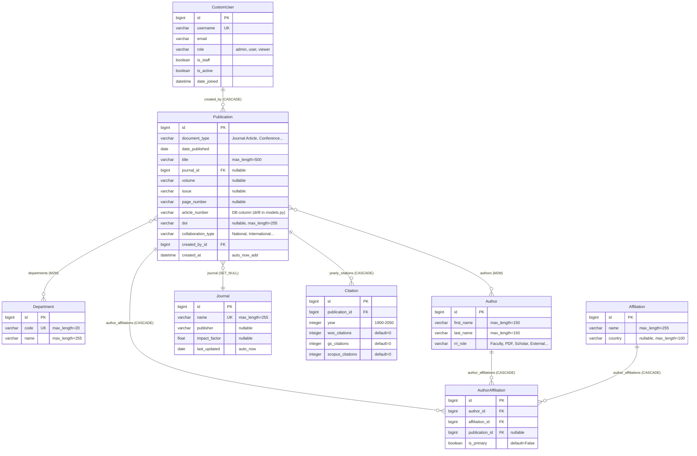

# Database and Data Model: RRI Publications Dashboard

## 1. Database Architecture and Schema Overview

The application utilizes an embedded **SQLite 3** database located at [`db.sqlite3`](../../db.sqlite3) for local development and demonstration. The schema is defined through Django's Object-Relational Mapping (ORM) layer across two applications: `accounts` (identity and user records) and `publications` (bibliometrics, authorship, and institutional metadata). The `dashboard` application owns zero database models, operating entirely as an analytics and presentation consumer of the `publications` schema.



---

## 2. Model-by-Model Specifications

### 2.1 `accounts.CustomUser`
- **Source**: [`accounts/models.py:7-17`](../../accounts/models.py#L7-L17)
- **Inheritance**: `django.contrib.auth.models.AbstractUser`
- **Table Name**: `accounts_customuser`
- **Purpose**: System identity representation replacing Django's default `User`, extending it with institutional role classification.

| Field Name | Type | Constraints & Options | Description |
| :--- | :--- | :--- | :--- |
| `id` | `BigAutoField` | Primary Key, Auto-increment | Internal surrogate key |
| `username` | `CharField(150)` | Unique, Unicode validator | Login identifier |
| `email` | `EmailField(254)` | Blank permitted | User email address |
| `role` | `CharField(10)` | Choices: `admin`, `user`, `viewer`; Default: `viewer` | Application authorization role |
| `is_staff` | `BooleanField` | Default: `False` | Access grant for `/admin/` portal |
| `is_active` | `BooleanField` | Default: `True` | Account operational status |
| `date_joined` | `DateTimeField` | Default: `timezone.now` | Account creation timestamp |

- **Model Invariants & Methods**:
  - `__str__()`: Returns `"{username} ({role})"`.
- **Audit / History**: Inherits standard Django auth timestamp fields (`last_login`, `date_joined`).

---

### 2.2 `publications.Department`
- **Source**: [`publications/models.py:12-21`](../../publications/models.py#L12-L21)
- **Table Name**: `publications_department`
- **Purpose**: RRI academic research divisions (e.g., Astronomy & Astrophysics, Light & Matter Physics, Soft Condensed Matter, Theoretical Physics).

| Field Name | Type | Constraints & Options | Description |
| :--- | :--- | :--- | :--- |
| `id` | `BigAutoField` | Primary Key, Auto-increment | Unique department identifier |
| `code` | `CharField(20)` | `unique=True` | Institutional acronym (e.g., `AAP`, `LAMP`) |
| `name` | `CharField(255)` | `blank=False`, `null=False` | Full official department title |

- **Meta**: `ordering = ['name']`
- **Reverse Relationships**: `publications`: Many-to-many reverse lookup to `Publication`.

---

### 2.3 `publications.Journal`
- **Source**: [`publications/models.py:27-35`](../../publications/models.py#L27-L35)
- **Table Name**: `publications_journal`
- **Purpose**: Academic periodicals and publishing venues; stores journal impact factors.

| Field Name | Type | Constraints & Options | Description |
| :--- | :--- | :--- | :--- |
| `id` | `BigAutoField` | Primary Key, Auto-increment | Journal identifier |
| `name` | `CharField(255)` | `unique=True` | Full journal name (e.g., *Physical Review Letters*) |
| `publisher` | `CharField(255)` | `blank=True`, `null=True` | Commercial/academic publisher (e.g., *AIP*, *Elsevier*) |
| `impact_factor`| `FloatField` | `blank=True`, `null=True` | Journal Citation Reports (JCR) Impact Factor |
| `last_updated` | `DateField` | `auto_now=True` | Last modification timestamp |

- **Reverse Relationships**: `publication_set`: Foreign key reverse lookup from `Publication`.

---

### 2.4 `publications.Author`
- **Source**: [`publications/models.py:40-70`](../../publications/models.py#L40-L70)
- **Table Name**: `publications_author`
- **Purpose**: Individual researchers, scholars, students, and external co-authors.

| Field Name | Type | Constraints & Options | Description |
| :--- | :--- | :--- | :--- |
| `id` | `BigAutoField` | Primary Key, Auto-increment | Author identifier |
| `first_name` | `CharField(150)` | `blank=False`, `null=False` | Given name or initials |
| `last_name` | `CharField(150)` | `blank=False`, `null=False` | Family name / surname |
| `rri_role` | `CharField(100)`| `blank=True`, `null=True`, Choices: `Faculty`, `Retired Faculty`, `Adjunct Faculty`, `Research Scholar`, `Post Doctoral Fellow (PDF)`, `Research Assistant/Associate (RA)`, `Staff`, `External` | Institutional rank or relationship |

- **Meta**: `ordering = ['last_name', 'first_name']`
- **Reverse Relationships**:
  - `publications`: Many-to-many relationship to `Publication`.
  - `author_affiliations`: Reverse foreign key to `AuthorAffiliation`.

---

### 2.5 `publications.Affiliation`
- **Source**: [`publications/models.py:75-87`](../../publications/models.py#L75-L87)
- **Table Name**: `publications_affiliation`
- **Purpose**: Institutional organizations, universities, and laboratories associated with research authors.

| Field Name | Type | Constraints & Options | Description |
| :--- | :--- | :--- | :--- |
| `id` | `BigAutoField` | Primary Key, Auto-increment | Affiliation identifier |
| `name` | `CharField(255)` | `blank=False`, `null=False` | Organization name and address text |
| `country` | `CharField(100)` | `blank=True`, `null=True` | Extracted nation of the organization |

- **Meta**: `ordering = ['name']`, `verbose_name = "Affiliation"`

---

### 2.6 `publications.AuthorAffiliation`
- **Source**: [`publications/models.py:92-120`](../../publications/models.py#L92-L120)
- **Table Name**: `publications_authoraffiliation`
- **Purpose**: Granular many-to-many junction model linking authors, affiliations, and specific publications. Captures an author's affiliation at the exact moment a paper was published.

| Field Name | Type | Constraints & Options | Description |
| :--- | :--- | :--- | :--- |
| `id` | `BigAutoField` | Primary Key, Auto-increment | Junction identifier |
| `author` | `ForeignKey(Author)` | `on_delete=models.CASCADE`, `related_name="author_affiliations"` | Associated author |
| `affiliation` | `ForeignKey(Affiliation)` | `on_delete=models.CASCADE`, `related_name="author_affiliations"` | Associated organization |
| `publication` | `ForeignKey(Publication)` | `on_delete=models.CASCADE`, `related_name="author_affiliations"`, `blank=True`, `null=True` | Specific publication context |
| `is_primary` | `BooleanField` | `default=False` | Denotes primary institutional affiliation |

---

### 2.7 `publications.Publication`
- **Source**: [`publications/models.py:125-200`](../../publications/models.py#L125-L200)
- **Table Name**: `publications_publication`
- **Purpose**: Central bibliographic entity representing scientific papers, articles, conference proceedings, and patents.

| Field Name | Type | Constraints & Options | Description |
| :--- | :--- | :--- | :--- |
| `id` | `BigAutoField` | Primary Key, Auto-increment | Publication identifier |
| `document_type` | `CharField(50)` | Choices: `Journal Article`, `Miscellaneous Article`, `Conference Paper`, `Book/Book Chapter`, `Editorial`, `Letter`, `Patent`, `Book Review` | Document genre |
| `date_published` | `DateField` | `blank=False`, `null=False` | Publication date |
| `title` | `CharField(500)` | `blank=False`, `null=False` | Article title |
| `journal` | `ForeignKey(Journal)` | `on_delete=models.SET_NULL`, `null=True`, `blank=True` | Publishing journal |
| `volume` | `CharField(50)` | `blank=True`, `null=True` | Journal volume number |
| `issue` | `CharField(50)` | `blank=True`, `null=True` | Journal issue number |
| `page_number` | `CharField(50)` | `blank=True`, `null=True` | Page span (e.g. `102-115`) or article number |
| `article_number` | `CharField(50)` | **Present in DB / Missing in models.py** | Article citation identifier (schema drift) |
| `doi` | `CharField(255)` | `blank=True`, `null=True` | Digital Object Identifier |
| `collaboration_type` | `CharField(50)` | Choices: `National`, `International`, `National/International`, `Departmental` | Collaboration scope |
| `departments` | `ManyToManyField(Department)` | `related_name="publications"`, `blank=True` | Associated RRI departments |
| `authors` | `ManyToManyField(Author)` | `related_name="publications"`, `blank=True` | Author roster |
| `created_by` | `ForeignKey(CustomUser)` | `on_delete=models.CASCADE` | Staff/user who uploaded the record |
| `created_at` | `DateTimeField` | `auto_now_add=True` | System record insertion timestamp |

- **Meta**: `ordering = ["-date_published"]`
- **Methods**:
  - `get_absolute_url()`: Returns `reverse("publications:publication_detail", args=[self.id])`.

---

### 2.8 `publications.Citation`
- **Source**: [`publications/models.py:205-228`](../../publications/models.py#L205-L228)
- **Table Name**: `publications_citation`
- **Purpose**: Tracks year-over-year citation counts for a publication across different indexing engines.

| Field Name | Type | Constraints & Options | Description |
| :--- | :--- | :--- | :--- |
| `id` | `BigAutoField` | Primary Key, Auto-increment | Citation record identifier |
| `publication` | `ForeignKey(Publication)` | `on_delete=models.CASCADE`, `related_name="yearly_citations"` | Associated publication |
| `year` | `IntegerField` | Choices: `1900..2050` | Citation calendar year |
| `wos_citations` | `PositiveIntegerField` | `default=0` | Web of Science citation count |
| `gs_citations` | `PositiveIntegerField` | `default=0` | Google Scholar citation count |
| `scopus_citations`| `PositiveIntegerField` | `default=0` | Scopus citation count |

- **Constraints**: `unique_together = ("publication", "year")`
- **Meta**: `ordering = ['year']`

---

## 3. Critical Schema Drift Analysis: `article_number`

```
Migration 0002 (Applied in Database)           publications/models.py (Current Source Code)
+------------------------------------+         +------------------------------------+
| model_name: 'publication'          |         | class Publication(models.Model):   |
| name: 'article_number'             |   !=    |     volume = models.CharField(...) |
| field: models.CharField(           |         |     issue = models.CharField(...)  |
|     blank=True, max_length=50,     |         |     page_number = ...              |
|     null=True)                     |         |     doi = models.CharField(...)    |
+------------------------------------+         +------------------------------------+
```

### Verified Evidence:
1. Migration file [`publications/migrations/0002_alter_publication_options_publication_article_number.py`](../../publications/migrations/0002_alter_publication_options_publication_article_number.py) was applied to `db.sqlite3` on `2026-10-24 05:00:50`.
2. Inspecting `PRAGMA table_info(publications_publication)` confirms the physical column exists:
   ```sql
   ['id', 'document_type', 'date_published', 'title', 'volume', 'issue', 'page_number', 'doi', 'collaboration_type', 'created_at', 'created_by_id', 'journal_id', 'article_number']
   ```
3. However, `article_number` is missing from `Publication` in [`publications/models.py:125-200`](../../publications/models.py#L125-L200).
4. Executing `python manage.py makemigrations --dry-run` results in:
   ```
   Migrations for 'publications':
     publications/migrations/0003_alter_publication_options_and_more.py
       ~ Change Meta options on publication
       - Remove field article_number from publication
   ```
5. **Impact**: If any developer runs `makemigrations` and applies it, Django will generate a destructive migration dropping the `article_number` column and any stored data.
6. **Required Fix**: Add `article_number = models.CharField(max_length=50, blank=True, null=True)` back to `Publication` in `publications/models.py`.

---

## 4. Data Integrity and Deletion Risks

1. **Dangerous Cascade Deletion on `Publication.created_by`**:
   - `created_by = models.ForeignKey(settings.AUTH_USER_MODEL, on_delete=models.CASCADE)`
   - **Critical Vulnerability**: If a library officer or administrator account is deleted in Django Admin, **all publications uploaded by that user will be permanently deleted via SQL CASCADE**, triggering cascading deletes of all associated `AuthorAffiliation` and `Citation` records.
   - **Remediation**: Change to `on_delete=models.PROTECT` or `on_delete=models.SET_NULL, null=True`.
2. **Missing Author Uniqueness Constraint**:
   - `Author` has no unique constraint or composite index on `(first_name, last_name)`.
   - Every file import in `wos_save` creates duplicate author rows, requiring expensive in-memory deduplication in analytical views.
3. **Missing Indexes on High-Traffic Query Fields**:
   - Fields frequently filtered or sorted by `DynamicFilter` lack database indexes:
     - `Publication.date_published` (heavily sorted and range-filtered)
     - `Publication.document_type` (heavily filtered)
     - `Publication.collaboration_type` (heavily filtered)
     - `Publication.doi` (frequently searched)
   - Indexes should be declared in `Meta.indexes` for production scale.

