# Dependencies and Modernization: RRI Publications Dashboard

## 1. Dependency Analysis and Modernization Matrix

| Dependency | Declared / Installed | Current Usage in Codebase | Maintenance Status | Upgrade Blocker / Risk | Target Version / Action | Complexity |
| :--- | :--- | :--- | :--- | :--- | :--- | :--- |
| **Django** | `6.0.6` | Core framework, ORM, Auth, Admin, Views | **Modern & Active** | None; modern Django 6.0 installed | Retain `6.0.x` | None |
| **django-filter** | `25.2` | Powers dynamic URL query parameter filtering ([`dashboard/filters.py`](../../dashboard/filters.py)) | **Modern & Active** | None; fully compatible with Django 6.0 | Retain `25.2` | None |
| **django-tailwind** | `4.5.0` | Theme app integration and template tags | **Active** | Built around Tailwind v3; project uses Tailwind v4 | Retain or migrate to standalone CLI | Low |
| **django-browser-reload**| `1.21.0` | Hot reloading in development | **Active** | None | Retain (dev only) | None |
| **Tailwind CSS** | `4.3.0` (npm) | CSS styling framework ([`package.json`](../../theme/static_src/package.json)) | **Modern & Active** | Tailwind v4 uses `@import "tailwindcss";` | Retain `^4.3.0` | None |
| **DaisyUI** | `5.5.23` (npm)| Component classes (`stats`, `card`, `btn`, `table`) | **Modern & Active** | DaisyUI 5 plugin integration | Retain `^5.5.23` | None |
| **Alpine.js** | `3.x` (bundled) | Sidebar toggle, hamburger menu, UI state | **Stable** | Bundled static file in `static/js/` | Retain local vendor file | None |
| **Chart.js** | `4.x` (bundled) | Canvas charts in dashboard and catalog | **Stable** | Bundled static file in `static/js/` | Retain local vendor file | None |
| **Lucide Icons** | `0.x` (bundled) | UI iconography | **Active** | Bundled static file in `static/js/` | Retain local vendor file | None |
| **requests** | `2.34.2` | **Unused** (0 imports) | Active | None | **Remove** from `requirements.txt` | Low |
| **arrow** | `1.4.0` | **Unused** (0 imports) | Active | None | **Remove** from `requirements.txt` | Low |
| **cookiecutter** | `2.7.1` | **Tooling remnant** (0 imports) | Active | None | **Remove** from `requirements.txt` | Low |
| **honcho** | `2.0.0` | **Unused** (0 imports) | Active | None | **Remove** from `requirements.txt` | Low |
| **pytailwindcss** | `0.3.1` | **Redundant** (npm handles Tailwind) | Active | None | **Remove** from `requirements.txt` | Low |
| **django-tables2** | *Uninstalled* | Imported in [`dashboard/tables.py:1`](../../dashboard/tables.py#L1) (phantom) | Active | Unused code imports missing package | **Remove** `dashboard/tables.py` | Low |
| **django-crontab** | *Uninstalled* | Referenced in [`makefile:130-138`](../../makefile#L130-L138) | Maintenance lulled | Requires Linux crontab | Remove recipe or install library | Low |

---

## 2. Categorized Modernization Plan

```mermaid
graph TD
    subgraph Phase_1 ["1. Safe Routine Cleanup (Immediate)"]
        CleanReqs["Remove unused packages from requirements.txt<br>(requests, arrow, cookiecutter, honcho, pytailwindcss)"]
        CleanDeadCode["Delete dead/phantom code<br>(publications/views_dashboard.py, dashboard/tables.py)"]
        FixDoctype["Fix duplicate DOCTYPE in base.html"]
    end
    
    subgraph Phase_2 ["2. Configuration & Schema Stabilization"]
        FixEnv["Implement django-environ / python-dotenv<br>(Ingest SECRET_KEY, DEBUG, ALLOWED_HOSTS from .env)"]
        FixStaticRoot["Add STATIC_ROOT = BASE_DIR / 'staticfiles'"]
        FixArticleNumber["Restore article_number to Publication model<br>(Resolve schema drift)"]
        FixCascade["Change created_by to on_delete=models.PROTECT"]
    end
    
    subgraph Phase_3 ["3. Security & Operational Hardening"]
        EnforceRBAC["Implement role-based authorization guards<br>(@role_required for WoS upload & review)"]
        ProtectDash["Add LoginRequiredMixin to private dashboards"]
        FixPagination["Fix pagination filter preservation in pagination.html"]
        AddIndexes["Add database indexes on Publication fields"]
    end
    
    subgraph Phase_4 ["4. Architecture & Scalability Evolution"]
        AuthorDedup["Database-level Author canonicalization model<br>(Eliminate in-memory merging)"]
        PostgresMigration["Migrate SQLite to PostgreSQL in production"]
        AsyncIngestion["Move WoS ingestion to background task queue<br>(Celery / Django-Q)"]
        AddTestCoverage["Implement automated test suite (pytest-django)"]
    end

    Phase_1 --> Phase_2 --> Phase_3 --> Phase_4
```



---

## 3. Detailed Upgrade and Remediation Paths

### 3.1 Tier 1: Routine Cleanup (Zero Risk)
1. **Purge Unused Python Packages**:
   - Prune `requirements.txt` by removing `requests`, `arrow`, `cookiecutter`, `honcho`, and `pytailwindcss`.
   - Result: Shorter deployment install times and reduced supply chain attack surface.
2. **Remove Dead Source Code**:
   - Delete [`publications/views_dashboard.py`](../../publications/views_dashboard.py).
   - Delete [`dashboard/tables.py`](../../dashboard/tables.py).
3. **Fix `dashboard/templates/base.html` Markup**:
   - Clean up duplicate `<!doctype html>` and `<html>` tags on lines 1-6 and trailing `</html>` tags on lines 79-80.

### 3.2 Tier 2: Configuration Hygiene and Schema Correction
1. **Adopt `django-environ`**:
   - Install `django-environ` to parse `.env` files cleanly into `settings.py`:
     ```python
     import environ
     env = environ.Env(DEBUG=(bool, False))
     environ.Env.read_env(BASE_DIR / ".env")

     SECRET_KEY = env("DJANGO_SECRET_KEY")
     DEBUG = env("DEBUG")
     ALLOWED_HOSTS = env.list("ALLOWED_HOSTS", default=["localhost"])
     ```
2. **Resolve Schema Drift**:
   - Add `article_number = models.CharField(max_length=50, blank=True, null=True)` to `Publication` in [`publications/models.py`](../../publications/models.py).
   - Verify `python manage.py makemigrations --dry-run` reports zero pending schema changes.
3. **Enable Static File Collection**:
   - Define `STATIC_ROOT = BASE_DIR / "staticfiles"` in `settings.py` so `python manage.py collectstatic` succeeds during deployments.

### 3.3 Tier 3: Security & Architectural Improvements
1. **Author Canonicalization Architecture**:
   - Currently, each WoS import creates duplicate `Author` records.
   - Introduce an `AuthorAlias` or canonical lookup table, or use `Author.objects.get_or_create(first_name=..., last_name=...)` with an institutional affiliation match.
   - Refactor [`dashboard/views.py`](../../dashboard/views.py) to delegate counts, averages, and sorting directly to database SQL, eliminating memory-bound Python merging.
2. **Asynchronous Ingestion**:
   - Replace session-stored WoS staging with a temporary database staging model (`StagedPublication` / `StagedAuthor`).
   - Process large uploads asynchronously using Celery or Django-Q to prevent HTTP request timeouts.

